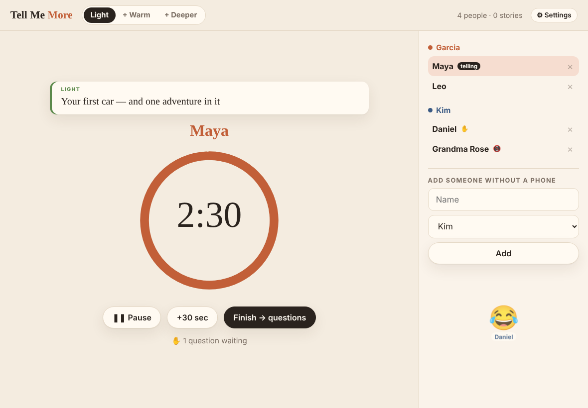
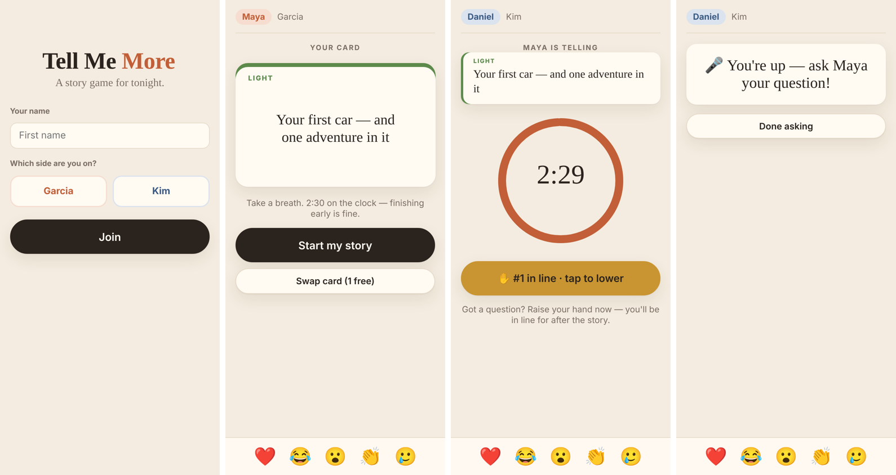

# Tell Me More — a story game for gatherings

Draw a card, tell a short true story against a gentle timer, then take questions.
The tablet is the shared table screen; everyone else joins from their phone.

No installs: Python 3.8+ standard library only.





## Run it

```bash
cd tell-me-more
python3 server.py
```

It prints three addresses:

```
Tablet (host):   http://192.168.1.20:8765/host?key=a1b2c3
Guests' phones:  http://192.168.1.20:8765
Keepsake:        http://192.168.1.20:8765/keepsake
```

1. Open the **host** link on the tablet. Tip: in Safari, Share → Add to Home Screen gives you full-screen.
2. Open ⚙︎ Settings and set the two sides' names (e.g. your family name and theirs) and the story length.
3. Guests scan the QR code on the tablet (or type the address) and pick their side.
4. For anyone who'd rather not use a phone, use "Add someone without a phone" on the tablet; the host taps for them.

The host key changes each run. Use `--host-key something` to keep it fixed, or `--port 9000` to change the port.

## How a turn works

1. **Ready.** The next storyteller is picked automatically. Everyone tells once before anyone tells twice, and turns alternate between the two sides. Tap any name to pick someone else instead.
2. **Draw.** The storyteller taps the card, on their phone or on the tablet. They get **one free swap** per game. The host can swap any time, or write a one-off prompt ("Tell us about the proposal!").
3. **Tell.** A ring timer counts down (2½ min by default). It turns gold for the last 30 seconds and plays a soft chime at zero. Nothing cuts anyone off, and the host can pause or add 30 seconds.
4. **Questions.** People raise a hand on their phone. **The other side's hands go to the front of the line**, since that's where families get to know each other. The storyteller or host taps "Call on".
5. **Next storyteller →**

Phones can also send ❤️ 😂 😮 👏 🥲, which float up on the tablet.

## Depth levels

The buttons at the top of the tablet control which prompts can be drawn:

- **Light**: easy, fun stories. Good for the first round.
- **+ Warm**: adds family, love, advice, and growing up.
- **+ Deeper**: adds hard years, fears, and people we miss. Open this only when the room feels ready.

Edit `prompts.json` to add your own. Changes apply on the next card, with no restart.

## Keepsake

Every finished story is logged with the teller, their side, the prompt, and who asked questions.
The tablet's Settings has a "Story keepsake" link, and `/keepsake.md` downloads it as text.
Each game is also saved as JSON in `stories/`. It could be nice material for a wedding toast.

## If phones can't connect

- **macOS firewall:** the first run may ask "Allow incoming connections for Python?" Click Allow. If you missed it, check System Settings → Network → Firewall → Options.
- **Same network:** phones must be on your home Wi-Fi, not cellular. Many routers' *guest* networks block device-to-device traffic, so put guests on the main network or turn off "client isolation" for the evening.
- The QR code is drawn by a small library loaded from the internet. If the tablet is offline it's skipped and the address is shown instead.

## License

MIT
